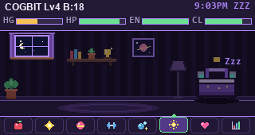
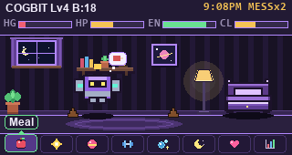
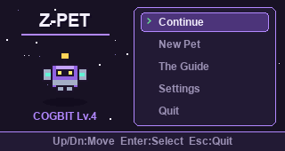
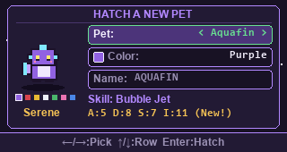
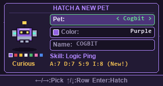

# Z-Pet

A pocket pixel-art virtual pet RPG built for the **M5Stack Cardputer Zero** (`320×170` SPI display) with full PC preview support. Raise one of 5 unique starter companions, customize their coat color and name, train their battle stats, fight wild Z-Pets and Elite Bosses in the Battle Arena, listen to a built-in procedural 8-bit soundtrack, and unlock **35 Baby, Teen, and Adult evolutions** shaped by how you care for them.

<p align="center">
  
</p>

## Gallery

| Title Screen | The Guide |
| :---: | :---: |
|  |  |
| **Star Catch Mini-Game** | **Care-Driven Evolution** |
|  |  |

---

## Quick Controls

Z-Pet uses unified directional controls across menus, mini-games, battles, and the bedroom dock—supporting both standard arrow keys and the Cardputer Zero's left-hand cluster:

| Action | Keys |
| :--- | :--- |
| **Up / Down** | `↑` / `↓` or `F` / `X` |
| **Left / Right** | `←` / `→` or `Z` / `C` |
| **Select / Confirm / Action** | `Enter` or `Space` |
| **Back / Save & Menu / Quit** | `Esc` or `Q` |
| **Open The Guide** *(from Status screen)* | `G` |
| **Switch Guide Tabs** | `←` / `→`, `Tab`, or `1` / `2` / `3` |
| **Speaker Volume Up / Down / Mute** *(Cardputer Zero)* | `fn + D` / `fn + S` / `fn + A` |
| **Take `320×170` Screenshot** | `0` *(Cardputer Zero)* or `F12` *(PC)* |

> **Tip when naming a New Pet:** While the **Name** field is selected, `F`, `X`, `Z`, and `C` type letters normally—use the physical arrow keys or `Tab` to switch rows. Leave the name blank and press `Enter` to keep the starter's default name.

---

## Understanding the Screen & HUD

### Top Status Bar
* **Top-Left (`NAME Lv# B:#`):** Your pet's name, current **Level** (`Lv1`–`Lv30`), and **Bond** (`B:0`–`999`).
* **Top-Right (`Clock + Status`):** Real-time clock (`12h` or `24h` in Settings) followed by your pet's live status badge:
  * **`OK`** — Awake and doing fine.
  * **`ZZZ`** — Tucked into bed and recovering Energy.
  * **`MESSx#`** — Floor messes need cleaning.
  * **`WEAK`** — Hunger dropped to `5%` or below, or your pet has gone 36+ hours without care.
  * **`FAINT`** — Pet collapsed after 48 full hours unattended (press `Enter` to hatch a new egg).

### Care Bars (Top Row)
Each bar fills from `0%` to `100%` and shifts color by urgency (**Green** ≥ 60%, **Yellow** 30–59%, **Red** below 30%):

| Label | Meaning | How to Restore |
| :---: | :--- | :--- |
| **`HG`** | **Hunger** — How full your pet is (~21 hours full-to-empty while awake). Hitting `0%` triggers `WEAK` and Care Mistakes, not instant death. | Feed a **Meal** (Apple) or **Treat** (Star). |
| **`HP`** | **Happiness** — Your pet's mood (not Battle Hit Points). Low mood affects care quality. | Play **Star Catch**, give a **Treat**, or **Hug**. |
| **`EN`** | **Energy** — Stamina spent on playing (`15%` min), training (`15%` min), and battling (`18%` min). | Put your pet to **Bed** (Moon icon). |
| **`CL`** | **Cleanliness** — Drops over time and whenever floor messes appear. | Use **Clean** (Bubbles icon). |

### 2-Day Unattended Survival Rule
Z-Pet is tuned for casual pocket-pet play rather than punishing instant deaths:
* **48-Hour Grace Window:** Your pet only faints if left completely unattended for **2 full days (48 hours)**—tracked across both active sessions and offline time (up to 72 hours of catch-up).
* **Instant Reset:** Performing **any** care action (Meal, Treat, Play, Train, Battle, Clean, Bed/Wake, or Hug) resets the 48-hour unattended timer back to zero.
* **Care Mistakes (`MST`):** Leaving `HG`, `HP`, or `CL` below `15%` (or 3+ floor messes uncleaned) for **60+ minutes** adds `+1 MST`, which steers future evolutions toward the **Wild** path without killing your pet.

### Bottom Action Dock (9 Icons)
Slide across the dock with **`←` / `→`** (`Z` / `C`) and press **`Enter` / `Space`** to trigger the highlighted icon. A floating tooltip names the selected icon, and a **pulsing red dot** flags any stat that needs attention:

| Icon | Action | What It Does |
| :--- | :--- | :--- |
| **Apple** | **Meal** | Restores `+25` Hunger (`+29` for Bold pets), `+1` Bond, and awards XP. |
| **Golden Star** | **Treat** | Restores `+10` Hunger & `+14` Happiness, builds Bond, and awards XP. |
| **Striped Ball** | **Play** | Launches the 20-second **Star Catch** mini-game. |
| **Dumbbell** | **Train** | Opens **Teach** timing drills to permanently raise battle stats. |
| **Crossed Swords** | **Battle** | Enters the turn-based **Battle Arena** against wild Z-Pets and Elite Bosses. |
| **Soap Bubbles** | **Clean** | Sweeps away floor messes, restores Cleanliness to `100%`, and awards XP. |
| **Moon / Sun** | **Bed / Wake** | Walks your pet to bed, tucks them under the covers, dims the floor lamp, and switches to somber lullaby music. Recharges Energy at `1.25%/min` (~80 min full rest). Swaps to a **Sun** icon while asleep. |
| **Heart** | **Hug** | Gives pets & affection (`+6` Happiness; `+3` Bond & XP every 6 seconds). |
| **Bar Chart** | **Status** | Opens the **Pet Status** profile (XP bar, battle stats, Arena records, Care Path forecast, and `[G]` shortcut to **The Guide**). |

### Bedroom Details
* **Clock-Synced Window:** Displays **Dawn**, **Day** (drifting clouds), **Sunset**, or **Night** (twinkling stars & moon) synced to your real-time clock—or locked to any preset in **Settings**.
* **Standing Floor Lamp:** Glows warmly while awake and switches off automatically as the room dims for bedtime.
* **Star Catch Trophy:** Turns gleaming gold and sparkles on the wall shelf once you record a **Star Catch** high score.
* **Boss Crown Trophy:** Unlocks on the right side of the bedroom shelf once your pet defeats at least one **Elite Boss** (`BOSS >= 1`). Features a sweeping golden glint, animated pixel sparkles, and a center jewel that upgrades with your lifetime Boss wins:
  * **1 Win (Alpha):** Crimson ruby
  * **2 Wins (Apex):** Ice cyan
  * **3 Wins (Titan):** Royal purple
  * **4+ Wins (Mythic):** Prismatic diamond-lavender
* **Thought Bubbles:** Pop up beside your pet whenever Hunger, Cleanliness, Energy, or Happiness runs low.

---

## Status Screen & Battle Stats

Open the **Status** icon (Bar Chart) to inspect your pet's RPG profile, Arena records, and live evolution forecast:

| Label | Meaning & Combat Role |
| :---: | :--- |
| **`ATK`** | **Attack** (`max 150`) — Scales standard **Strike** damage and physical signature abilities. |
| **`DEF`** | **Defense** (`max 150`) — Increases **Max HP** (`55 + Lv×8 + DEF×2`), reduces incoming damage (`60 / (60 + DEF)`), and boosts **Guard** healing. |
| **`SPD`** | **Speed** (`max 150`) — Determines who acts first each turn, increases **Critical Hit** odds, and adds **Dodge** chance (up to `18%`) against slower rivals. |
| **`INT`** | **Intelligence** (`max 150`) — Powers elemental/magic & hybrid skills, amplifies all signature abilities, boosts healing skills, and grants up to a `30%` chance to refund **`+1 SP`** after casting. |
| **`XP`** | **Experience Points** — Earned from care, Star Catch, Teach drills, and Arena fights up to **Lv. 30**. |
| **`BND`** | **Bond** — Affection score built through daily care, play, training, and victories (also boosts Bond-scaled healing skills). |
| **`MST`** | **Care Mistakes** — Logged per hour of severe neglect (`< 15%` stat or 3+ floor messes). |
| **`TRN`** | **Daily Drills Remaining** — Remaining Teach sessions today (`3/3` max, resets at midnight). |
| **`BOSS`** | **Elite Boss Wins** — Total 5-win Boss Challenges defeated (also unlocks and upgrades the **Boss Crown** shelf trophy). |
| **`BEST`** | **Best Win Streak** — Highest consecutive Battle Arena win streak reached. |
| **`W`** | **Total Wins** — Lifetime Battle Arena victories. |
| **`Skill`** | Your pet's active species signature ability (all 35 species have a unique battle skill). |

---

## Activities

### Battle Arena (`Battle`)
Select the **Crossed Swords** icon (requires an awake pet with ≥ `18%` Energy and ≥ `15%` Hunger) to challenge wild Z-Pets scaled to your level (`±1`, Lv. 1–30) and evolution stage (**Babies** at Lv. 1–9, **Teens** at Lv. 10–19, **Adults** at Lv. 20–30).

* **SP System:** Both fighters begin with **`1 SP`** (up to **`3 SP`** shown as gold pips next to the HP bar).
  * **Strike** — Physical attack scaled by `ATK`; generates **`+1 SP`**.
  * **Skill** *(costs `2 SP`)* — Unleashes your species' unique signature ability (priority strikes, DEF-pierce, lifesteal, burns, thorns, reflect barriers, double-hits, heals, stat buffs/debuffs, or low-HP revenge surges). Highlight **Skill** to preview its name on the center bar.
  * **Guard** — Cuts incoming damage in half for the turn, recovers a small amount of HP scaled by `DEF`, and generates **`+1 SP`**.
  * **Flee** — Safely returns to the bedroom.
* **Rewards & Streaks:** Winning awards level-scaled **XP**, **Bond**, and builds your persistent **Win Streak** (`STRK` / `W`). Losing resets your current streak and sends your pet home tired with consolation XP instead of fainting them.

#### Elite Boss Challenges (Every 5th Streak Fight)
Reaching a **4-win streak** flashes a **`NEXT: ELITE BOSS!`** warning—every 5th consecutive match (`#5`, `#10`, `#15`, `#20+`) transforms the Arena into a crimson-gold **Boss Challenge**:

| Boss Tier | Streak Fight | Boss Boosts | Victory Rewards |
| :---: | :---: | :--- | :--- |
| **ALPHA** | Fight #5 | Player Lv. `+1`, `+16%` stats, **`1.35×` Max HP**, starts with **`2 SP`** | **`1.75× + 15` Bonus XP**, `+5`–`+9` Bond, **`+2` permanent stat**, `+1 BOSS` win |
| **APEX** | Fight #10 | Player Lv. `+1`, `+19%` stats, **`1.35×` Max HP**, starts with **`2 SP`** | Same Boss Bonus scaling with higher streak XP |
| **TITAN** | Fight #15 | Player Lv. `+2`, `+22%` stats, **`1.35×` Max HP**, starts with **`2 SP`** | Same Boss Bonus scaling with higher streak XP |
| **MYTHIC** | Fight #20+ | Player Lv. `+2`–`+3`, up to `+30%` stats, **`1.35×` Max HP**, **`2 SP`** | Same Boss Bonus scaling with higher streak XP |

Elite Bosses wear a **pixel crown badge** with a pulsing aura, read your `2 SP` charge to Guard defensively, and use their signature skills aggressively. Defeating one permanently boosts a random non-maxed battle stat (`ATK`, `DEF`, `SPD`, or `INT`) by **`+2`** and unlocks/upgrades the **Boss Crown** trophy on your bedroom shelf.

### Star Catch (`Play`)
A 20-second arcade mini-game: move left and right to catch falling **Gold Stars** (`+1`) and rare **Pink Mega-Stars** (`+3`) while dodging **Storm Bolts** (`-1` & brief stun). Reaching a **5+ catch combo** adds `+1` bonus point per star, and scoring **12+ points** awards a permanent **`+1 SPD`** bonus.

### Teach Drills (`Train`)
Choose **ATK**, **DEF**, **SPD**, or **INT** and complete a 3-round timing-bar challenge. Hitting the center gold zone scores **PERFECT** (`+2` pts) and green scores **GOOD** (`+1` pt), granting permanent `+1` to `+3` stat gains (`+4` on Perfect for Curious pets), Bond, and XP. Capped at **3 sessions per calendar day**.

---

## Procedural 8-Bit Audio & Soundtrack

Z-Pet includes a zero-asset band-limited wavetable chiptune engine (`core/sound.py`) synthesized directly in memory with Python's `math` and `array` modules plus `pygame.mixer`—no `.wav` or `.ogg` files required, tuned natively for the Cardputer Zero's **48 kHz single-channel (mono)** speaker via PipeWire, and degrading silently if no sound hardware is present.

* **4-Tier Independent Mix (`OFF` / `LOW` / `MED` / `HIGH`):** Mixer Channel `0` is reserved for background music while Channels `1–7` handle sound effects. Adjusting **Sound FX** or **Music** in **Settings** scales channel volume live (`0%` / `28%` / `60%` / `100%`) without restarting the active track or affecting the other channel.
* **Cardputer Zero Hardware Volume Keys:** Press **`fn + D`** (Volume Up), **`fn + S`** (Volume Down), or **`fn + A`** (Mute) from any screen to adjust the live PipeWire speaker volume in `5%` steps via `wpctl` without leaving the game. A compact **`VOL ##%` / `MUTED`** bar pops up at the top of the screen for 1.8 seconds and auto-unmutes when raising volume.
* **Retro Sound Effects (`Sound FX`):** Covers UI navigation (`click`, `select`, `back`, `error`), every care action (`feed`, `treat`, `clean`, `hug`, `sleep`, `wake`), Star Catch cues (`catch`, `mega_catch`, `combo`, `bolt`), Teach timing hits (`drill_perfect`, `drill_good`, `drill_miss`), full Battle Arena feedback (`hit`, `crit`, `skill`, `guard`, `dodge`, `heal`, `boss` intro, `victory`, `defeat`), plus `level_up` and `evolve` fanfares.
* **Multi-Section Mood Playlists (`Music`):** Full 48–64 beat arrangements (`A → B → A' → C`) with harmony arpeggios and 8-bit percussion, built section-by-section on a background thread and queued gaplessly for stutter-free playback on Cardputer Zero:

| Mood Playlist | Active Scenes | Shuffled Tracks & Vibe |
| :--- | :--- | :--- |
| **`day`** | Menus, Status, Guide & Bedroom (Awake / Daytime) | 3 cozy chiptune songs (~32–34s each) that flow seamlessly across menus and the bedroom without restarting. |
| **`somber`** | Menus & Bedroom (Sleeping, Fainted, or Nighttime `8 PM–5 AM` / `Night` sky) | 2 slow minor-key music-box bell lullabies (~44–46s each) that switch in automatically at bedtime or night. |
| **`minigame`** | Star Catch & Teach Drills | 2 upbeat arcade synth tracks (~26–27s each) with retro drums. |
| **`battle`** | Battle Arena (Wild Fights) | 2 driving RPG combat tracks (~26–27s each). |
| **`boss`** | Battle Arena (Elite Boss Challenges) | 4-phase high-tension boss rush theme (~24s gapless loop). |

---

## Starters, Base Colors & Personalities

When starting a **New Pet**, choose from **5 Starter Species**, **7 Base Colors** (**Purple, Red, Yellow, White, Green, Pink, Blue**), and an optional custom name. Every starter line has a unique **Personality Trait** with active gameplay effects:

| Starter | Personality | Perks | Trade-off | Starting Stats (`A/D/S/I`) | Starter Skill |
| :--- | :--- | :--- | :--- | :---: | :--- |
| **Sparkkit** | **Hyper** | `+25%` Star Catch XP, `25%` faster walk | Hunger drains `15%` faster | `8 / 5 / 12 / 6` | *Static Pounce* |
| **Cinderpup** | **Bold** | `+25%` Teach XP, `+4` extra meal Hunger | Energy drains `10%` faster | `11 / 8 / 7 / 5` | *Ember Bite* |
| **Aquafin** | **Serene** | Energy drains `20%` slower, `+20%` sleep recovery | Clean drains `10%` faster | `5 / 8 / 7 / 11` | *Bubble Jet* |
| **Sproutowl** | **Gentle** | `+1` Bond on Hug/Treat, Hunger drains `20%` slower | Calm, slower walk | `6 / 11 / 6 / 8` | *Leaf Flurry* |
| **Cogbit** | **Curious** | `+25%` Care XP, `+1` bonus stat on Perfect drill | Happiness drains `15%` faster | `7 / 7 / 9 / 8` | *Logic Ping* |

---

## 3-Stage Care Evolution System (35 Species)

Pets level up from **Lv. 1 to Lv. 30**, evolving automatically when awake at **Lv. 10 (Teen)** and **Lv. 20 (Adult)**. How you raise your pet steers it into one of three distinct forms—and **Teens can still switch care paths** before hitting Lv. 20:

* **Radiant Care:** Attentive, high-Bond care with very few mistakes (**Teen:** 0–1 MST & Bond 20+ · **Adult:** 0–2 MST & Bond 45+).
* **Trained Care:** Focused on daily Teach drills (**Teen:** 4+ drills & ≤ 2 MST · **Adult:** 9+ drills & ≤ 3 MST).
* **Wild Care:** Scrappy rogue path triggered by neglect or low Bond/drills (**Teen:** 3+ MST · **Adult:** 5+ MST). Wild forms aren't weak—they evolve into fierce, high-offense specialists.

| Starter (Baby, Lv. 1) | Teen Forms (Lv. 10 — Radiant / Trained / Wild) | Adult Forms (Lv. 20 — Radiant / Trained / Wild) |
| :--- | :--- | :--- |
| **Sparkkit** | Starlynx / Joltkat / Feralvolt | Aethercat / Voltlynx / Stormclaw |
| **Cinderpup** | Sunpup / Blazehound / Charfang | Solhound / Pyrofang / Ashmaw |
| **Aquafin** | Reefkin / Wavecrest / Murkfin | Coralshell / Tidedrake / Abyssfin |
| **Sproutowl** | Petalowl / Barkwing / Bramblet | Bloomwing / Ironbark / Thornbeak |
| **Cogbit** | Gildbot / Gearunit / Staticbit | Chronowing / Mechaforge / Glitchvex |

---

## The Guide & Settings

* **The Guide** *(Start-Up Menu or `[G]` in Status)*: Tracks all **35 species** permanently in `guide.json` across new playthroughs (showing silhouettes and unlock hints for undiscovered forms), plus quick-reference tabs for **Traits** and **Care** rules.
* **Settings** *(saved in `config.json`)*:
  * **Sound FX:** `OFF`, `LOW`, `MED`, or `HIGH` *(plays a preview chime at each level; independent of Music)*.
  * **Music:** `OFF`, `LOW`, `MED`, or `HIGH` *(scales live without restarting the track; independent of Sound FX)*.
  * **Clock Format:** `12-Hour` or `24-Hour`.
  * **Window Sky:** `Auto` (real clock), `Dawn`, `Day`, `Sunset`, or `Night` *(also switches Day/Somber music immediately)*.
  * **Game Speed:** `1x Normal`, `10x Fast`, or `60x Test`.

---

## Running & Installing

### On Cardputer Zero (1.9" Display via `/dev/fb_lcd`)
```bash
git clone [https://github.com/delos23/z-pet.git](https://github.com/delos23/z-pet.git) ~/z-pet
cd ~/z-pet
chmod +x deploy/install_launcher.sh deploy/run_zpet.sh
./deploy/install_launcher.sh
```
Launch **Z-Pet** directly from **APPLaunch**. Z-Pet renders natively to `/dev/fb_lcd` (even if HDMI is connected), outputs 48 kHz mono audio through PipeWire, and stores persistent data in `~/.config/z-pet/`:
* `save.json` — Active pet state, Battle Arena win streaks, Boss wins, and 48-hour survival tracking.
* `config.json` — User preferences (`sfx`, `music`, clock format, sky mode, and game speed).
* `guide.json` — Permanent 35-species discovery progress.
* `launch.log` — Startup diagnostics for `/dev/fb_lcd`, PipeWire audio, and active BGM tracks.

> **Audio Note on Cardputer Zero:** Use **`fn + D`** / **`fn + S`** / **`fn + A`** inside Z-Pet to control the built-in speaker directly. If the speaker is still silent over SSH, check `wpctl get-volume @DEFAULT_AUDIO_SINK@` and unmute/raise with `wpctl set-mute @DEFAULT_AUDIO_SINK@ 0 && wpctl set-volume @DEFAULT_AUDIO_SINK@ 0.65`.

### On Windows / Linux PC (Development Preview)
```bash
pip install pygame-ce
python tools/generate_species_sprites.py
python main.py
```
Pass `--window` on Linux devices if you want a desktop preview window instead of `/dev/fb_lcd`.

---

## License
MIT License — Created by **Aaron Bumbarger** (`delos23`).